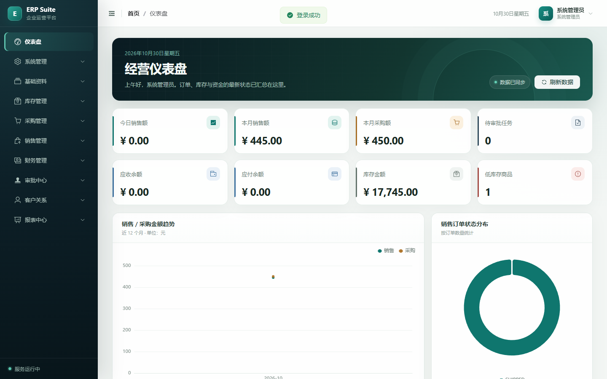
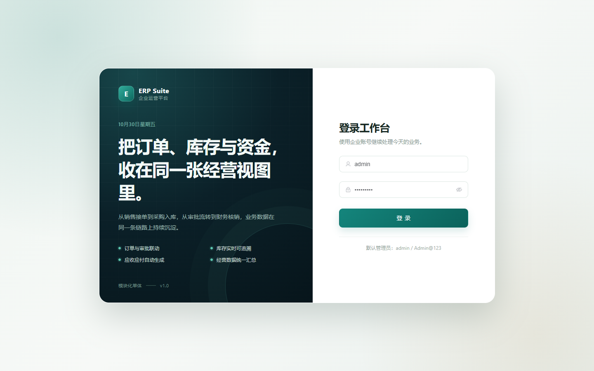
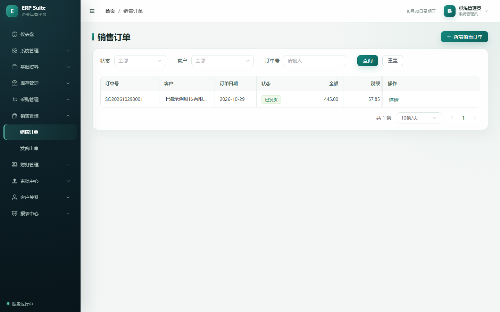
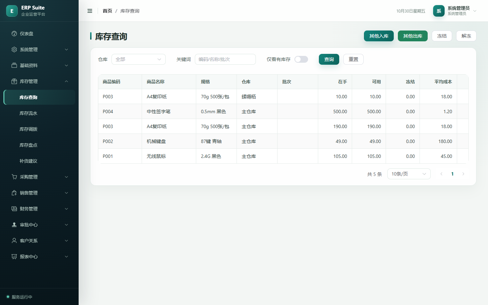
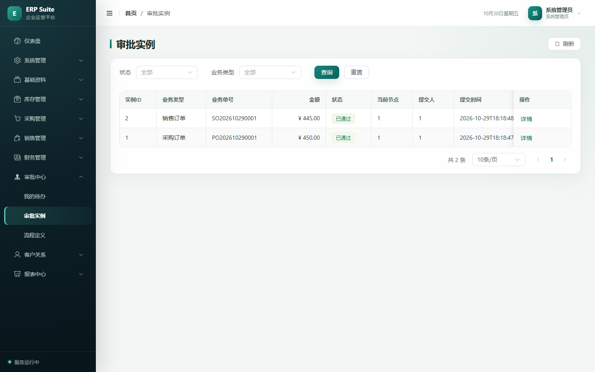
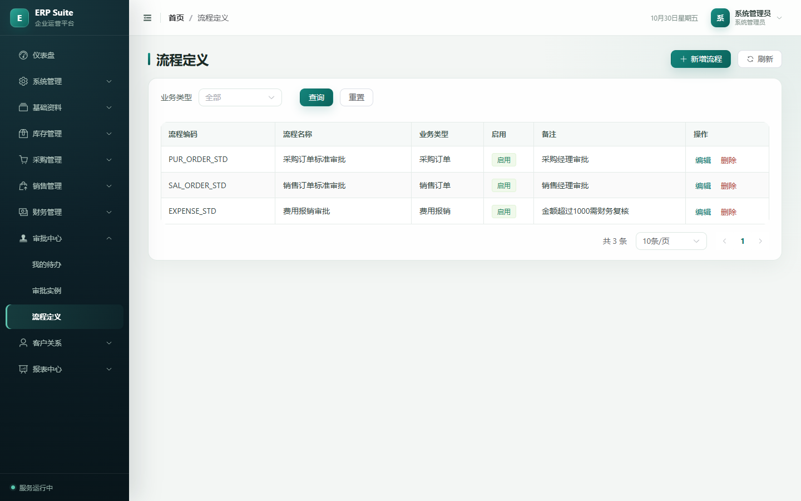
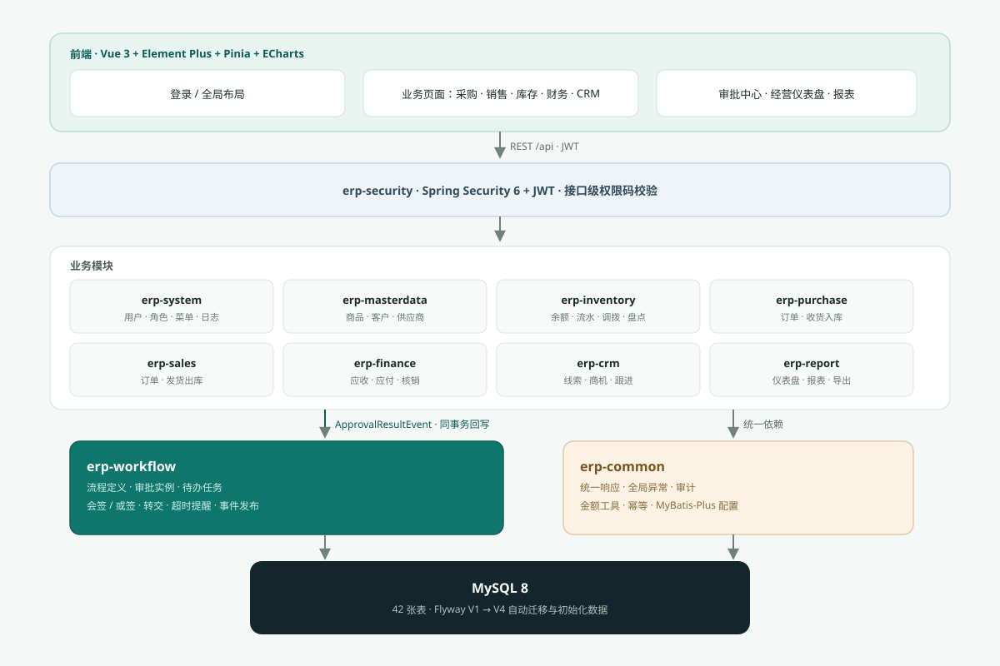
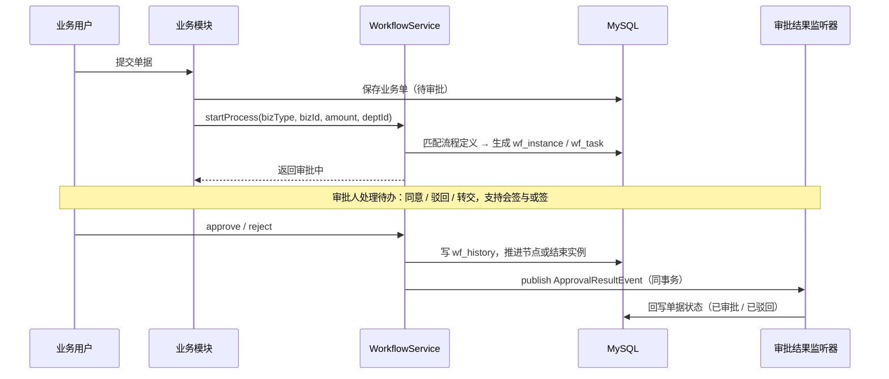

<div align="center">

# Atlas ERP

**企业运营管理系统 · Enterprise Resource Planning**

商品、库存、采购、销售、资金与审批，收在同一张经营视图里。


</div>

## 项目简介

> Atlas ERP is a modular-monolith ERP built with Spring Boot 3 and Vue 3. It covers master data, inventory,
> purchasing, sales, finance, an approval workflow engine, CRM and reporting, and ships with Flyway
> migrations, role-based access control and end-to-end tests. Everything runs locally with one MySQL instance.

Atlas ERP 是一套可直接运行的模块化单体 ERP：业务模块共享同一套统一响应、异常、审计、金额与幂等能力，审批流作为横切能力串联采购、销售等单据，审批结果在同事务内回写业务状态。前端使用统一设计 token 覆盖 Element Plus 主题，配合按钮级权限与图表看板。

## 功能特性

| 领域 | 能力 |
| --- | --- |
| 系统管理 | 用户、角色、菜单、部门、字典、参数、操作日志、序列号、幂等控制 |
| 基础资料 | 商品与分类、计量单位、客户、供应商、仓库 |
| 库存 | 库存余额查询、出入库流水、调拨、盘点、补货建议，加权平均成本核算 |
| 采购 | 采购订单、收货入库，审批通过后自动生成入库单 |
| 销售 | 销售订单、发货出库，审批通过后扣减库存并生成应收 |
| 财务 | 应收 / 应付、收款 / 付款、核销、资金账户 |
| 审批流 | 流程定义（角色 / 用户 + 金额区间 + 部门限定）、审批实例、我的待办、审批历史；支持会签 / 或签、转交、超时提醒 |
| CRM | 客户线索、商机、跟进记录 |
| 报表 | 经营仪表盘、销售 / 采购 / 库存报表、CSV 导出 |
| 前端体验 | 统一设计 token 与主题、按钮级权限、图表看板、响应式布局 |

## 界面预览

经营仪表盘：顶部经营概览带 + 8 张核心指标卡 + 销售趋势与采购结构图表。



| 登录页 | 销售订单 |
| --- | --- |
|  |  |

| 库存查询 | 审批实例 |
| --- | --- |
|  |  |

流程定义维护：查询区、流程表格与分页，侧边栏按角色高亮当前菜单。



## 系统架构



前端通过 JWT 访问 `/api`，Spring Security 统一鉴权后分发到各业务模块；业务模块依赖 `erp-common` 的响应、异常、审计、金额与幂等能力，最终由 MyBatis-Plus 落到 MySQL。

审批采用「业务单据 → 流程实例 → 待办任务」的联动模型：业务模块发起流程时写入实例与待办，审批结束发布 `ApprovalResultEvent`，监听器在同一事务内回写单据状态，避免单据与审批状态不一致。



## 技术栈

| 层 | 技术 |
| --- | --- |
| 后端 | Java 21、Spring Boot 3.3.5、Spring Security 6、MyBatis-Plus 3.5.7 |
| 数据库 | MySQL 8、Flyway（V1 → V4 迁移脚本）、HikariCP |
| 前端 | Vue 3、JavaScript、Vite 6、Element Plus、Pinia、Vue Router、Axios、ECharts 5 |
| 测试 | JUnit 5、Spring Boot Test、Playwright（本机 Microsoft Edge） |
| 交付 | Maven 多模块、Docker Compose、Nginx 静态托管 |

## 快速开始

### 环境要求

JDK 21、Maven 3.9+、Node 20+、MySQL 8。

```bash
# 1. 后端（默认连接 127.0.0.1:3307/erp）
cd backend
mvn -DskipTests package
java -jar erp-app/target/erp-app-1.0.0.jar    # http://localhost:8080

# 2. 前端
cd frontend
npm install
npm run dev                                   # 默认 http://localhost:5173，/api 代理到 8080
```

若 5173 已被其他项目占用，Vite 会自动顺延到 5174，请以终端输出地址为准。首次启动由 Flyway 自动建表并写入初始化数据。

### 默认账号

| 账号 | 密码 | 角色 |
| --- | --- | --- |
| `admin` | `Admin@123` | 系统管理员 |
| `salesmgr` / `sales01` | `Admin@123` | 销售经理 / 销售专员 |
| `purchasemgr` / `purchase01` | `Admin@123` | 采购经理 / 采购专员 |
| `wh01` | `Admin@123` | 仓库管理员 |
| `fin01` | `Admin@123` | 财务专员 |

## 配置项

| 环境变量 | 默认值 | 说明 |
| --- | --- | --- |
| `DB_URL` | `jdbc:mysql://127.0.0.1:3307/erp` | 数据库连接 |
| `DB_USER` / `DB_PASSWORD` | `erp` / `Erp@123456` | 数据库账号 |
| `SERVER_PORT` | `8080` | 后端端口 |
| `JWT_SECRET` | 内置开发密钥 | JWT 签名密钥，生产环境必须替换 |
| `JWT_EXPIRE_MINUTES` | `480` | 登录有效期（分钟） |

## Docker 部署

```bash
docker compose up -d --build
# 前端 http://localhost ，后端 http://localhost:8080 ，MySQL localhost:3306
```

首次启动由 Flyway 自动建表并写入初始化数据，详见 [部署说明](docs/07-deployment.md)。

## 测试与质量门禁

```bash
# 后端：单元 + 集成 + 权限 + 并发 + 金额 + 幂等 + 审批增强（25 个用例）
cd backend && mvn test

# 前端：静态检查 → 生产构建 → 端到端
cd frontend && npm run lint && npm run build && npm run e2e
```

E2E 使用 Playwright + 本机 Microsoft Edge，无需额外下载浏览器；需先启动后端与前端 dev server（或由 Playwright 自动拉起 `npm run dev`）。覆盖登录成功、未登录跳转、错误密码三类主流程。

## 项目结构

```
backend/                多模块 Maven 工程
  erp-common            统一响应/异常/审计/金额工具/MyBatis-Plus 配置
  erp-security          JWT、Spring Security、登录
  erp-system            用户/角色/菜单/部门/字典/参数/日志/序列/幂等
  erp-masterdata        商品/分类/单位/客户/供应商/仓库
  erp-inventory         库存余额/流水/调拨/盘点/补货
  erp-purchase          采购订单/收货入库
  erp-sales             销售订单/发货出库
  erp-finance           应收/应付/收款/付款/核销/资金账户
  erp-workflow          流程定义/审批实例/待办/审批回调事件
  erp-crm               线索/商机/跟进
  erp-report            仪表盘与销售/采购/库存报表、CSV 导出
  erp-app               启动模块、Flyway 迁移脚本、application.yml
frontend/               Vue 3 前端工程
  src/api               接口封装
  src/layout            侧边栏 + 顶栏布局
  src/views             各业务页面
  src/styles            全局设计 token 与 Element Plus 主题
  e2e                   Playwright 端到端用例
docs/                   需求、架构、数据库、API、页面、计划与项目状态
  images                界面截图与架构图
```

## 接口约定

- 统一前缀 `/api`，Swagger UI：`http://localhost:8080/swagger-ui.html`
- 统一响应体 `{ code, message, data }`，`code = 0` 表示成功
- 鉴权头 `Authorization: Bearer <token>`，接口通过 `@PreAuthorize` 校验权限码
- 分页参数 `page` / `size`，返回 `{ records, total, page, size }`

## 关键实现

- 认证：JWT（HS384）+ Spring Security 6，菜单与按钮权限由角色动态下发。
- 审批：`wf_process → wf_node（角色/用户 + 金额区间 + 部门）→ wf_instance → wf_task/wf_history`，支持会签（AND）/ 或签（OR）、审批转交、限时审批（超时标记 `overdue`）。
- 库存：`SELECT ... FOR UPDATE` 行锁 + 条件更新状态机，禁止负库存。
- 金额：全链路 `BigDecimal`，数量/单价精度 4 位、展示金额 2 位，统一 `HALF_UP`。
- 幂等：`sys_idempotency` 唯一键控制重复提交。

## 文档

| 文档 | 内容 |
| --- | --- |
| [需求说明](docs/01-requirements.md) | 业务范围、角色与用例 |
| [架构设计](docs/02-architecture.md) | 分层设计、模块职责、关键流程 |
| [数据库设计](docs/03-database.md) | 42 张表结构与关系 |
| [API 清单](docs/04-api.md) | 接口路径、参数与权限码 |
| [页面清单](docs/05-pages.md) | 页面与菜单结构 |
| [实施计划](docs/06-plan.md) | 阶段拆分与任务 |
| [部署说明](docs/07-deployment.md) | 本地、Docker、生产部署 |
| [项目状态](docs/PROJECT_STATUS.md) | 当前进度与验证结果 |

## 贡献

欢迎提交 Issue 与 Pull Request。开始前请阅读 [贡献指南](CONTRIBUTING.md)，其中包含本地开发、分支与提交信息规范、代码风格与自测要求。

## 许可证

本项目基于 [MIT License](LICENSE) 开源。
